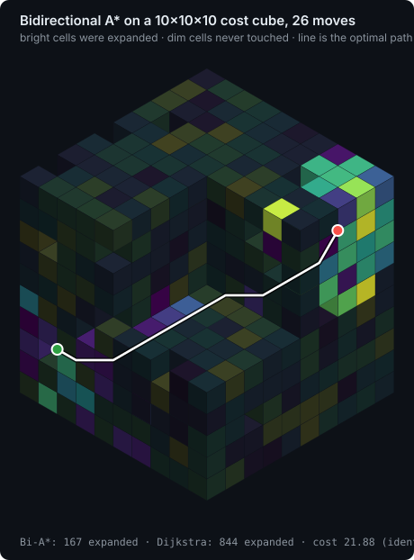
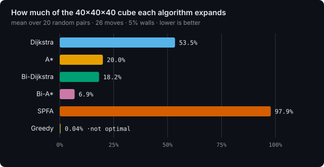
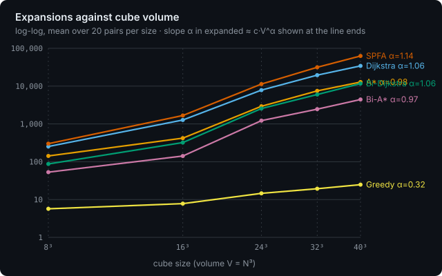

# deterministic-algorithm

Six shortest-path algorithms on a weighted 3D cube, with an interactive WebGL lab, a correctness suite and a benchmark CLI. Every run is reproducible: the same seed always rebuilds the same cube, and the same search always expands the same cells in the same order.

<p align="center">
  
</p>

> **Live lab:** https://vivekmlresearch.github.io/deterministic-algorithm/
> (enable Pages once: *Settings → Pages → Deploy from a branch → `main` / `/docs`*)

GitHub renders README files without running scripts, so the interactive parts live on the Pages site. The links below open it pre-configured, and the figures on this page are generated from real runs of the same code (`npm run assets`).

## Open an interactive version

Each link restores a cube size, seed, weights, start and end, then runs all six algorithms and shows the results table.

| Preset | What to look at | Link |
|---|---|---|
| **Default, 24³** | All six on one cube, 26 moves, 5% walls. Replay each search and compare the expanded regions. | [open](https://vivekmlresearch.github.io/deterministic-algorithm/?n=24&conn=26&obs=5&seed=20261024&run=all) |
| **Tiny, 8³** | Small enough to read every cell. Shows every cell colored by cost, with Bi-A* selected. | [open](https://vivekmlresearch.github.io/deterministic-algorithm/?n=8&conn=26&obs=0&seed=7&show=all&color=cost&view=biastar&run=all) |
| **Walled, 32³, 6 moves** | 25% walls and face-only moves force long detours. Bidirectional search pays off. | [open](https://vivekmlresearch.github.io/deterministic-algorithm/?n=32&conn=6&obs=25&seed=7&run=all) |
| **Inflated heuristic, ε = 2** | A* and Bi-A* trade optimality for fewer expansions. The Δ column shows the price. | [open](https://vivekmlresearch.github.io/deterministic-algorithm/?n=32&conn=26&eps=2&run=all) |
| **Zero-cost floor** | With minimum cost 0 the heuristic collapses to 0 and A* becomes Dijkstra. | [open](https://vivekmlresearch.github.io/deterministic-algorithm/?n=24&conn=26&min=0&run=all) |
| **Large, 64³** | 262,144 cells. Use the shell view and the cut-open button to look inside. | [open](https://vivekmlresearch.github.io/deterministic-algorithm/?n=64&conn=26&obs=5&run=all) |

URL parameters: `n` (3–100), `min`, `max` (cell cost range), `obs` (wall percent, 0–40), `conn` (6 or 26), `seed`, `eps` (heuristic scale, 0–3), `s` and `t` (start and end as `x,y,z`), `view` (`dijkstra`, `astar`, `bidijkstra`, `biastar`, `spfa`, `greedy`), `show` (`shell`, `all`, `explored`, `path`), `color` (`search`, `cost`), `run=all`. The **Copy link** button builds one for you.

Two earlier visualisations of the plain cost cube are kept in [`docs/demos`](docs/demos): [100 × 100 × 100](https://vivekmlresearch.github.io/deterministic-algorithm/demos/cost-cube.html) and [10 × 10 × 10](https://vivekmlresearch.github.io/deterministic-algorithm/demos/cost-cube-10.html).

## What the lab does

- **Cube size** from 3 to 100 per side (up to 1,000,000 cells), **reshuffle weights** with one click, **reset everything** to defaults.
- **Choose start and end** by clicking a cell (the click sets whichever of the two is selected), by typing coordinates, or with *Opposite corners*, *Random pair* and *Swap*.
- **Look inside the cube:** X, Y and Z slice sliders, a cost filter, *Cut open* and *Middle slab* presets, and views that show every cell, only the cells a search expanded, or only the path. To pick an interior cell, slice the cube and click the cut face.
- **Replay** any search step by step. Bidirectional searches color the forward and backward frontiers separately.
- **Benchmark table** per run: nodes expanded, distinct nodes, heap insertions, edges scanned, improving relaxations, re-openings, peak open-list size, working-set bytes, median time over repeated runs, path cost, hops and the gap to the optimal cost.
- **Batch benchmark** over many random start and end pairs, reporting mean, median, p95 and spread.
- **Copy** results as JSON or CSV to the clipboard, and copy a link that restores the exact configuration.

## Algorithms

| Algorithm | Data structure | Stops when | Time | Space | Exact |
|---|---|---|---|---|---|
| Dijkstra | Indexed binary heap with decrease-key | target is popped | O((V + E) log V) | O(V) | yes |
| A* | Indexed binary heap, re-opening of closed nodes | target is popped | O((V + E) log V), often far less | O(V) | yes for ε ≤ 1 |
| Bidirectional Dijkstra | Two heaps, reversed edges for the backward search | top_F + top_B ≥ best meeting cost | O((V + E) log V) | O(V) | yes |
| Bidirectional A* | Two heaps, consistent average potential | top_F + top_B ≥ best meeting cost (reduced costs) | O((V + E) log V) | O(V) | yes for ε ≤ 1 |
| SPFA (Bellman-Ford) | FIFO ring queue with in-queue flags, pruning against the best known target cost | queue is empty | O(V·E) worst case | O(V) | yes |
| Greedy best-first | Indexed binary heap keyed on hop distance only | target is popped | O(V log V) | O(V) | no |

### Cost model and heuristic

Moving from cell $u$ into neighbour $v$ costs $w[v]$, the weight of the cell you enter. The start cell's weight is never paid. Walls have infinite weight. Moves are the 6 face neighbours or all 26 neighbours.

With $d(v, t)$ the hop distance to the target (Manhattan for 6 moves, Chebyshev for 26) and $w_{\min}$ the smallest weight actually present in the grid:

$$h(v) = \varepsilon \cdot w_{\min} \cdot d(v, t)$$

One move changes $d$ by at most 1, so $h(u) - h(v) \le \varepsilon\, w_{\min} \le w[v]$ for $\varepsilon \le 1$. The heuristic is then admissible and consistent, so A* never re-expands a node and returns an optimal path. For $\varepsilon > 1$ the A* variants may return a costlier path in exchange for fewer expansions. If the minimum cost is 0 the heuristic is identically 0 and A* is Dijkstra.

### Bidirectional stopping rule

The backward search walks reversed edges: reaching $u$ from $v$ costs $w[v]$. Let $\mu$ be the cheapest meeting cost seen so far, updated whenever a relaxation touches a node the other side has already labelled. With $k_F$ and $k_B$ the smallest keys in the forward and backward open lists, the search stops when

$$k_F + k_B \ge \mu .$$

For Bidirectional A* both searches use the average potential $p(v) = \tfrac12\,(h_T(v) - h_S(v))$, with keys $g_F + p$ and $g_B - p$. The reduced cost of an edge is $w[v] + p(v) - p(u) \ge w[v] - \varepsilon w_{\min} \ge 0$, so both directions run Dijkstra on the same non-negative graph and the same stopping rule stays exact.

### Determinism

Weights come from a seeded `mulberry32` stream. Heaps break key ties on node index and neighbours are visited in a fixed order, so counters such as "nodes expanded" are identical on every machine. Only wall-clock times vary.

## Benchmarks

Measured with `node bench/run.js` (Node 22 on Linux x64, 20 random start and end pairs per size, seeded cubes, costs 1–10, 5% walls, ε = 1). Times are single timed runs after a JIT warm-up, so read medians, not single values, and trust expansion counts more than milliseconds.

<p align="center">
  
</p>

**40³ cube (64,000 cells), 26 moves**

| Algorithm | Expanded (mean) | Expanded / V | Time ms (median) | Time ms (p95) | Optimal | Mean gap |
|---|---:|---:|---:|---:|---:|---:|
| Dijkstra | 34,216 | 53.5% | 19.4 | 27.3 | 20/20 | 0.00% |
| A* | 12,800 | 20.0% | 5.44 | 15.2 | 20/20 | 0.00% |
| Bi-Dijkstra | 11,678 | 18.2% | 6.06 | 11.1 | 20/20 | 0.00% |
| Bi-A* | 4,422 | 6.9% | 3.21 | 8.00 | 20/20 | 0.00% |
| SPFA | 62,630 | 97.9% | 18.4 | 25.2 | 20/20 | 0.00% |
| Greedy | 25 | 0.0% | 0.16 | 0.38 | 0/20 | 148.54% |

**40³ cube, 6 moves**

| Algorithm | Expanded (mean) | Expanded / V | Time ms (median) | Time ms (p95) | Optimal | Mean gap |
|---|---:|---:|---:|---:|---:|---:|
| Dijkstra | 33,686 | 52.6% | 8.63 | 12.6 | 20/20 | 0.00% |
| A* | 19,539 | 30.5% | 4.46 | 9.86 | 20/20 | 0.00% |
| Bi-Dijkstra | 13,586 | 21.2% | 4.14 | 6.61 | 20/20 | 0.00% |
| Bi-A* | 8,227 | 12.9% | 3.29 | 5.13 | 20/20 | 0.00% |
| SPFA | 71,454 | 111.6% | 7.77 | 11.8 | 20/20 | 0.00% |
| Greedy | 44 | 0.1% | 0.15 | 0.38 | 0/20 | 73.77% |

What the numbers say:

- **Bidirectional A\* is the cheapest exact search here**, expanding about 7.7× fewer nodes than Dijkstra with 26 moves and 4.1× fewer with 6 moves, and finishing about 6× faster with 26 moves. All four optimal algorithms returned the identical cost on every pair.
- **Two balls beat one.** In free 3D space a search ball of radius $r$ holds about $r^3$ cells, and two balls of radius $r/2$ hold about $r^3/4$. Walls, random costs and the overlap where the two frontiers meet eat into that ideal: measured, bidirectional Dijkstra expands 34% of Dijkstra's nodes with 26 moves and 40% with 6 moves.
- **SPFA expands more than $V$ nodes with 6 moves** (111.6%). It re-expands a node whenever a cheaper label arrives, and with random weights that happens often. It still runs 5–10% faster than Dijkstra in wall-clock time here, but only because a FIFO queue is cheaper than a heap. Its worst case is $O(V \cdot E)$, and the expansion counts show where that comes from.
- **Greedy is fast and wrong.** It follows the hop distance and ignores cost, so it expands a few dozen nodes and returned the optimal path in 0 of 20 pairs.

<p align="center">
  
</p>

Fitted exponents of mean expansions against volume $V$ (sizes 8³ to 40³, 26 moves): Dijkstra 1.06, A\* 0.98, Bi-Dijkstra 1.06, Bi-A\* 0.97, SPFA 1.14, Greedy 0.32. The exact algorithms all scale roughly linearly in $V$ on these cubes. The heuristics change the constant, not the exponent. Full tables for both move sets are in [`bench/results-26.md`](bench/results-26.md) and [`bench/results-6.md`](bench/results-6.md).

Reproduce or extend:

```bash
node bench/run.js                                         # defaults: sizes 8,16,24,32,40, 20 pairs, 26 moves
node bench/run.js --sizes 16,32,48 --pairs 50 --conn 6 --obst 10 --eps 1
# all options are listed at the top of bench/run.js
```

## Correctness

`npm test` runs `test/verify.js`: every exact algorithm is compared against an independent $O(V^2)$ reference Dijkstra on many small random cubes (6 and 26 moves, with and without walls, including unreachable pairs). The last run made 27,006 checks over 2,682 reachable and 18 unreachable pairs, with 0 failures. Greedy is checked for valid paths that are never cheaper than optimal.

## Run it locally

```bash
git clone https://github.com/vivekmlresearch/deterministic-algorithm.git
cd deterministic-algorithm
npm start            # serves docs/ on http://localhost:8080 (no dependencies)
npm test
npm run bench
npm run assets       # regenerate the SVG figures from bench/results-26.json
```

The algorithms are a single dependency-free file, [`docs/js/algorithms.js`](docs/js/algorithms.js), that runs unchanged in the browser, in a Web Worker and in Node:

```js
const A = require('./docs/js/algorithms.js');
const grid = A.makeGrid({ n: 32, wmin: 1, wmax: 10, obst: 0.05, seed: 7 });
const s = 0, t = grid.total - 1;
const r = A.runOnce('biastar', grid, 26, s, t, { hscale: 1 });
console.log(r.cost, r.hops, r.stats.expanded);
```

## Project layout

```
docs/                 GitHub Pages site (served from /docs)
  index.html          the lab
  css/style.css
  js/algorithms.js    the six algorithms, grid generator, benchmark helpers
  js/app.js           3D view (three.js), worker plumbing, tables and charts
  demos/              the two earlier cost-cube visualisations
test/verify.js        correctness suite
bench/run.js          benchmark CLI, plus recorded results
scripts/              make-assets.js, build-single.js, serve.js
assets/               figures used by this README
```

## License

MIT, see [LICENSE](LICENSE).
